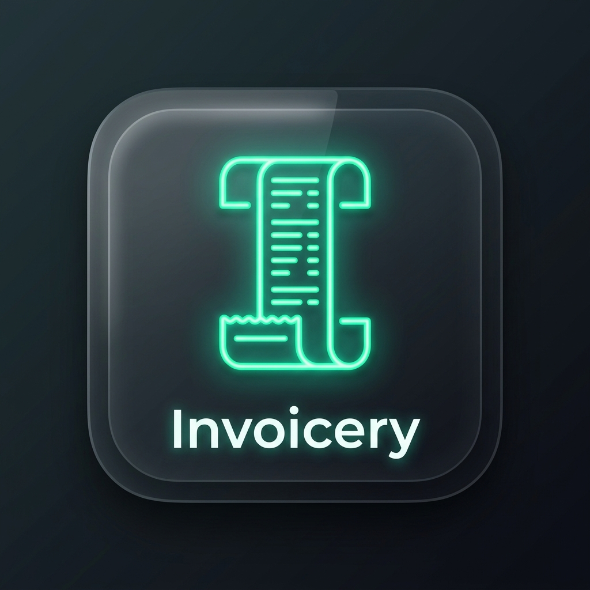
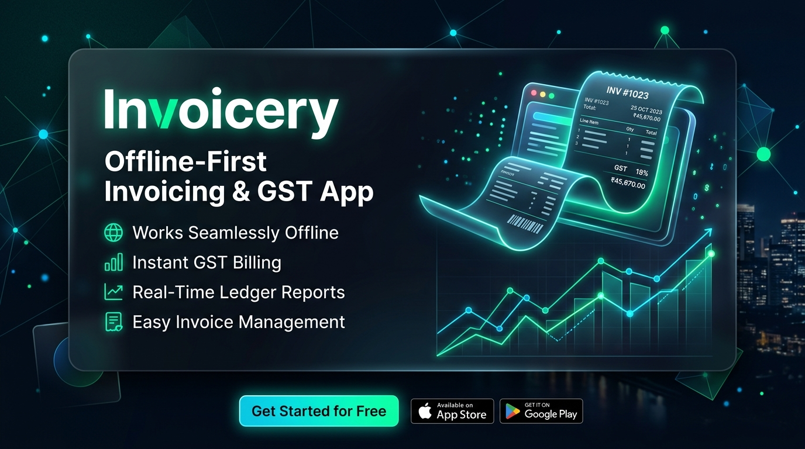
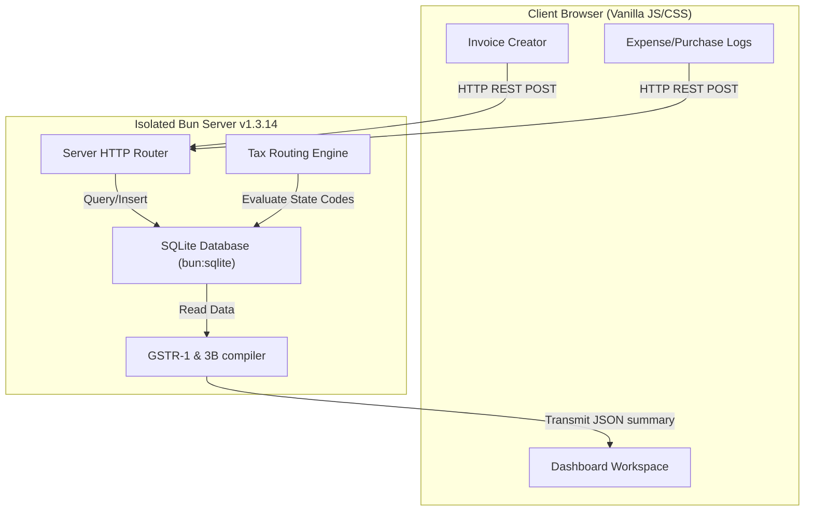

<p align="center">
  
</p>

# Invoicery ── Boutique Self-Hosted Invoicing & GST Assistant

<p align="center">
  
</p>

<p align="center">
  <strong>An elegant, offline-first billing dashboard, customer-ledger database, and Indian GST filing assistant.</strong><br />
  <em>Crafted with Bun, SQLite, and Vanilla JS/CSS. Self-contained, secure, and ready to self-host.</em>
</p>

<p align="center">
  <a href="#key-features">Features</a> •
  <a href="#local-installation">Installation</a> •
  <a href="#docker-deployment">Docker Freezing</a> •
  <a href="#how-the-magic-works">How it Works</a> •
  <a href="#developer-api">API Documentation</a> •
  <a href="#tests">Tests</a>
</p>

---

## 🔮 The Philosophy Behind the "Sorcery"

Traditional accounting tools are either heavy, bloated cloud services that harvest your business data, or overly simplified command line trackers. **Invoicery** is designed as a *boutique workshop* for your invoicing needs. 

It mixes the safety of an **offline-first local database** with the convenience of a modern web workspace. Bookkeeping shouldn't feel like a chore; with the right UI and automated tax routing, it feels like magic.

---

## ⚡ Key Features

* **Complete Local Data Ownership:** Runs entirely in your local network/environment. No third-party servers, no subscription fees, no data leaks.
* **Instant Tax Classification:** Input customer information once, and the backend tax engine calculates and applies CGST, SGST, or IGST based on the place of supply rules automatically.
* **Automated Indian GST Prep:** Instantly structures your transactions into audit registers ready for **GSTR-1** (B2B, B2CL, B2CS, CDNR, CDNUR, Export) and **GSTR-3B** tax filing.
* **Inventory Control & Ledger Sync:** Integrated stocks auto-deduct upon sales invoices and auto-increment upon recording purchases.
* **Modern Dark Aesthetics:** A bespoke UI constructed with high-contrast, premium dark mode styling and reactive SVG analytical widgets.
* **Bridges to External Apps:** A secure API token system lets you hook up scanning devices, command line utilities, or inventory scripts directly to your billing book.
* **Seamless Backups:** Pack up your entire database (`billing.db`) and uploaded files/receipts (`attachments/`) into a single portable zip file, and restore it with one click.

---

## 📐 How the Magic Works

Invoicery uses a lightweight local stack. Here is how your billing, expenses, and tax computations flow:



### The State Tax Logic
When you create an invoice, Invoicery checks the **Merchant State Code** (from settings) against the **Customer Place of Supply State Code**:
* **Match (Intrastate):** Split tax equally into **CGST** and **SGST** (e.g., 9% CGST + 9% SGST for an 18% rate).
* **Mismatch (Interstate):** Allocate the entire tax rate to **IGST** (e.g., 18% IGST).

---

## 🚀 Local Installation

### Prerequisites

Ensure you have the [Bun runtime](https://bun.sh/) installed.
```bash
curl -fsSL https://bun.sh/install | bash
```

### Running Locally

1. **Navigate to the workspace folder:**
   ```bash
   cd myZoho
   ```

2. **Install project dependencies & type definitions:**
   ```bash
   bun install
   ```

3. **Start the development server (runs with hot reloading):**
   ```bash
   bun run dev
   ```

4. **Start the production server:**
   ```bash
   bun run start
   ```

The application starts on port `3000` and binds only to `127.0.0.1` by default for local security compliance. Open **[http://localhost:3000](http://localhost:3000)** in your browser.

---

## 🐳 Docker Deployment (The Recommended Way to Freeze the App)

To freeze the environment and guarantee that future OS updates, library updates, or node runtime changes never break your billing system, run Invoicery inside an isolated Docker container.

1. **Build and start the services:**
   ```bash
   docker compose up -d --build
   ```
2. **Access the application:**
   Open **[http://localhost:3000](http://localhost:3000)**. Inside Docker, the server binds to `0.0.0.0` securely to allow port forwarding to your host.

3. **Persistent Directories:**
   The `docker-compose.yml` links directories from your host machine so your records are never lost when containers reboot:
   * `./billing.db` ── Persistent SQLite database file.
   * `./attachments/` ── Storehouse for invoice PDF and receipt uploads.

---

## ⚙️ Environment Variables

You can configure port and bindings easily. These are pre-configured in the Docker Compose workspace but can be modified for local runs:

| Variable | Default | Description |
| :--- | :--- | :--- |
| `PORT` | `3000` | Port server runs on |
| `HOST` | `127.0.0.1` | Binding address (set to `0.0.0.0` for Docker/LAN access) |
| `NODE_ENV` | `production` | Running profile flag |

---

## 🔌 Developer API

Invoicery includes a secure programmatic integration layer to connect custom external scripts.

### Authentication
Include one of the following credentials inside your HTTP headers (manage your custom keys in the **Settings** panel):

* **Custom Key Header:** `x-api-key: <your_key>`
* **Standard Authorization Header:** `Authorization: Bearer <your_key>`

### Key Endpoint Routings

| Method | Endpoint | Payload Format | Description |
| :--- | :--- | :--- | :--- |
| `GET` | `/api/dashboard` | `JSON` | Real-time analytics charts and summaries |
| `POST` | `/api/invoices` | `JSON` | Generates a sales record & subtracts stock |
| `POST` | `/api/purchases` | `JSON` | Creates a vendor receipt & increments stock |
| `POST` | `/api/products/adjust` | `JSON` | Direct stock adjustment override |
| `GET` | `/api/backup` | `Binary Stream` | Combines `billing.db` and attachments into a ZIP |
| `POST` | `/api/restore` | `Multipart FormData` | Overwrites active database from a backup ZIP |

---

## 🧪 Test Suite

Run the full local test suite (incorporating tax calculation rounding, schema validation, state matching, and layout integrity checks) via:

```bash
bun test
```
